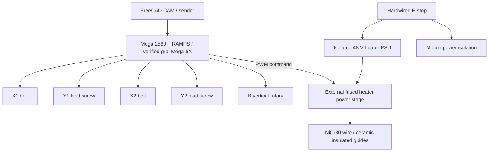
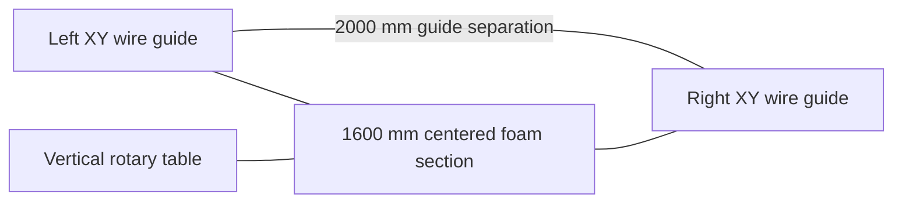

# 5-axis CNC hot-wire cutter — engineering design v0.2
Date: 2026-11-02. Status: preliminary, not fabrication release.

## Requirements
- 1,600 mm maximum foam wing-section span; 2,000 mm separation **between wire guide planes**.
- Four linear axes X1,Y1,X2,Y2; 400 mm usable travel each.
- Fifth B axis: vertical-axis rotary table, initially indexed cuts.
- Frame: braced 2040 aluminium T-slot extrusion; separate foam support.
- Centered workpiece leaves nominal 200 mm each side for fixtures and cutting clearance.

## Wire geometry and mechanical calculations
The greatest endpoint offset is 400 mm in both horizontal and vertical directions:
`Lmax=sqrt(2000^2+400^2+400^2)=2078.46 mm`.
Wire path increases by 78.46 mm compared with aligned 2,000 mm guide spacing. Wire cut length should initially be approximately **2,250 mm**, including attachment and tensioner allowance; verify all hardware geometry in CAD. A 2,000 mm cut wire is insufficient at maximum skew.

Wire: **NiCr80, 0.40 mm**. Preliminary assumed density 8,400 kg/m³, resistivity 1.09e-6 Ω·m, expansion coefficient 17e-6/K, temperature rise 250 K. These are assumptions requiring supplier and test confirmation.
- Cross-section `A=pi*d^2/4=1.2566e-7 m²`.
- Resistance `R=rho_e*L/A`: 8.67 Ω/m; at 1.9 m energized length approximately 16.48 Ω cold.
- Thermal expansion `deltaL=alpha*L*deltaT`: 8.5 mm at 2 m, 250 K rise.
- Weight per unit length `w=rho_m*A*g=0.01036 N/m`.
- Small-sag approximation `sag=w*L^2/(8*T)`: 0.65 mm at 8 N; 0.52 mm at 10 N, excluding cutting drag and bow.
- Initial target tension **8–10 N**; test hot strength and attachments.
- Need roughly 90 mm minimum effective take-up when geometric and thermal changes add, ideally **100–120 mm travel** plus hard stops.
- For a conventional extension spring, `F=F0+k*x`. To hold around 9 N across 100 mm with force variation ±1–1.5 N, target k around **0.020–0.030 N/mm** with correctly chosen preload; verify actual supplier curve. Prefer **8–10 N constant-force spring** with >=100 mm usable travel. No verified SKU yet. Alternative counterweight `m=F/g=0.92 kg` for 9 N, guarded.
- Spring and pulley stay outside the current path. Electrically isolate the wire at the guides with **Corning MACOR machinable glass ceramic** eyelets, and attach an electrically nonconductive, heat-appropriate cord beyond the insulated guide. Conductive clamps define energized length. No spring, frame, or bearing in electrical circuit.
- A 1,600 mm foam blank does not imply exactly 1,600 mm energized wire. Start with **1,800–1,900 mm active electrical span**, subject to the positions of current-injection clamps, guide clearance, and hot-end heat losses; otherwise energize the near-full guide span.

## Motion hardware selection
- Braced 2040 frame, gussets and adjustable alignment; verify bending under wire tension.
- Provisional **MGN12H profile guides**, 550–600 mm rails, two rails per axis: eight rails total; blocks eight minimum, possibly sixteen for improved moment stiffness. Rail and block quantities must be finalized in CAD.
- Horizontal X1/X2: **GT2, 2 mm pitch, 9 mm wide belt**, 20-tooth motor pulleys with correct shaft bore and matching 9 mm idlers; approximately 4 m belt purchase allowance.
- Belt travel/rev = 20*2 = **40 mm**. At 200 steps/rev and 1/16 microstepping: **80 steps/mm**.
- Vertical Y1/Y2: **T8×8 lead screws**, 550–600 mm, anti-backlash nuts and bearing supports; **400 steps/mm** at 200 steps/rev and 1/16 microstepping.
- Four provisional NEMA17 steppers around 0.45–0.6 N·m holding torque, pending carriage load, driver current and acceleration validation.
- B axis: vertical 250–300 mm rotary fixture with independently supported thrust bearing, worm reducer provisionally 30:1–60:1, stepper and home sensor. The swept volume of a 1.6 m workpiece may collide with towers: simulate before use.

## Electrical design
At R20=16.48 Ω, estimated cold wire loads: 24 V => 35 W / 1.46 A; 36 V => 79 W / 2.18 A; 48 V => 140 W / 2.91 A. Hot resistance and foam cutting conditions change actual performance. Recommend separate **isolated 48 V 5 A current-limited heating PSU** and external 48 V-rated fused fail-safe PWM controller; **never feed 48 V into RAMPS**. Initial separate motion PSU **24 V 10 A** subject to board and motor-driver ratings. E-stop physically removes dangerous power. Test heater-off on MCU reset, disconnect and wire failure.

## Architecture

## Software / commissioning
Retain Mega/RAMPS and grbl-Mega-5X as candidates, not verified five-axis integration. Confirm CPU pin mapping, four linear plus one rotary unit handling, synchronized 5-axis G-code, limit switches, endstop and spindle PWM pin assignments, 5-axis sender and FreeCAD FoamCut postprocessor. Freeze a tested firmware commit. Verify travel, clearance, sag, force across stroke, heater behavior, kerf, tapered-wing twist and B-axis collisions before production. Use ventilation, electrical guarding, fire protection, and only verified foam types (EPS/XPS initially).

## Named candidate products / references
- Corning **MACOR® machinable glass ceramic**: https://www.corning.com/worldwide/en/products/advanced-optics/product-materials/specialty-glass-and-glass-ceramics/glass-ceramics/macor.html
- Handson Technology **GT2-PL-20T-06** pulley and **MCH-1116** idler: **6 mm belt reference only**; source https://www.handsontec.com/dataspecs/GT2-pulley.pdf . For the recommended 9 mm belt, procure correctly matched 9 mm pulleys and idlers.
- MGN12H guide is a generic size designation; supplier/SKU and preload to be verified.
- 8–10 N constant-force spring with >=100 mm stroke is an engineering requirement; no validated catalog part number yet.

## Revision notes
Supersedes the previous assumption that RAMPS onboard MOSFET should directly power the wire. BOM tracked in `BOM.csv`. Original uploaded architecture is the starting topology; final CAD and safety sign-off remain outstanding.
