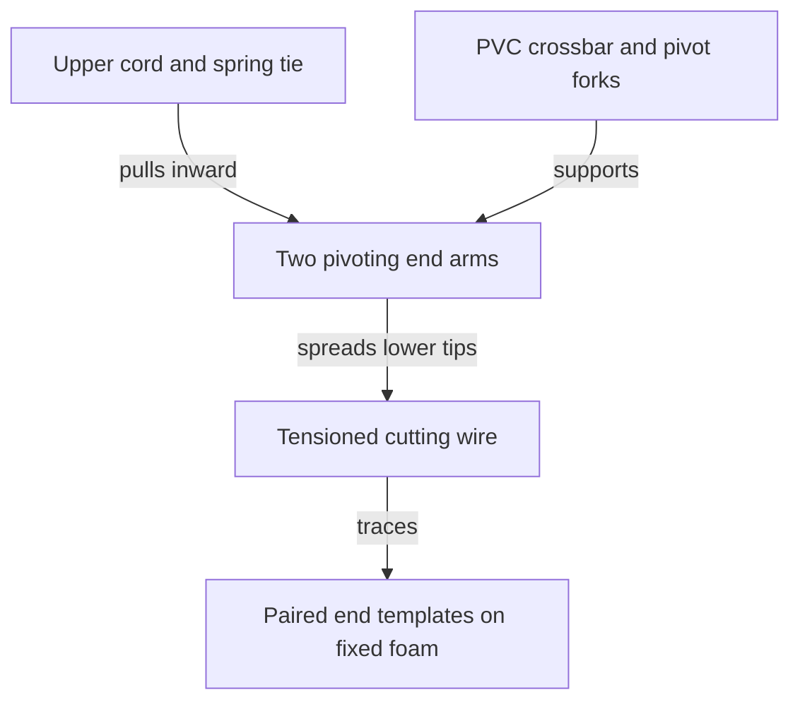
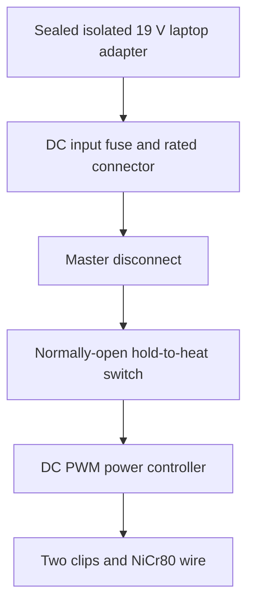

# Two-person manual hot-wire cutter architecture — M1, revision 0.1

Date: 2026-11-06. Preliminary design for EPS/XPS foam; build and thermal performance are unverified. This is independent of the root CNC architecture and its CAD dimensions.

## 1. Design basis

Confirmed requirements: two-person manual tracing; a profile guide on each end of the foam; PVC H-frame; passive spring tensioning; a standard 19 V laptop charger; use the available 3D printer for suitable components; CAD comes later.

| Parameter | Proposed baseline | Meaning / limitation |
| --- | --- | --- |
| Foam span along X | 1,000 mm | Working assumption; not inherited from the 1,600 mm CNC requirement |
| Lower wire attachment spacing S | 1,200 mm cold, nominal | Leaves approximately 100 mm at each foam end; includes space for hands/fixtures only after checking actual layout |
| Energized length Le | Approximately 1,150–1,200 mm | Between electrical clips, not raw cut length; calculation baseline is 1,200 mm |
| Wire stock cut length | Approximately 1,400 mm | Includes cold attachment tails; finalize after detailing clamps |
| Throat a | 350 mm, pivot axis to wire line | Useful depth is less after pipe radius, foam support and handling clearance; target about 300 mm usable |
| Upper lever b | 200 mm, pivot axis to spring tie | Gives nominal spring/wire force ratio 1.75 |
| Arm length | Approximately 550 mm each | Continuous pipe, pivot between upper and lower ends; fittings add envelope |
| Frame stock | Pressure-rated PVC, nominal 1 inch / DN25 candidate | Match one pipe standard; ASTM-style OD may be 33.4 mm; metric 32 mm OD is an alternative, not an interchangeable fitting |
| Wire | NiCr80, 0.40 mm diameter | Starting choice for strength and about 35 W maximum at this span |
| Wire tension | Start at 3 N; explore 3–5 N | Engineering test range, not a verified allowable load |
| Power source | Isolated 19 V DC laptop adapter, >=3.42 A / 65 W | Read actual label, polarity and connector; charger wattage is a ceiling, not delivered wire power |
| Heater adjustment | DC PWM controller, manual dial | Open-loop power control; no temperature regulation |

Coordinate convention: X runs from operator A to operator B along the wire. Z runs from lower cutting wire toward the upper tension tie within the frame plane. Y is perpendicular to that plane. The whole bow is free to translate and tilt during cutting.

## 2. Mechanical layout and load path

An H consists of two short end arms joined near their middles by a long crossbar. **The hot wire joins the lower tips of the two arms**, parallel to the crossbar; it does not run along a PVC leg. Above the crossbar, a nonconductive cord plus an extension spring joins the two upper tips, also parallel to the wire. One person holds each end arm near its pivot, away from the hot wire and spring pinch points.

Use a bolted pivot between each continuous PVC arm and a fork at each crossbar end. Both pivot axes are parallel to Y, allowing the arms to turn slightly in the X–Z plane. The upper tie pulls upper tips inward, causing lower tips to spread and tension the wire. As the wire expands, the spring contracts and takes up slack. Provide limited travel, mechanical stops, large load-spreading saddles and captured pivot bolts.

**Do not substitute two glued rigid tees for these pivots:** a rigid H with an upper spring has no defined lever action. A rigid-tee alternative requires a separate sliding insulated wire terminal with its own spring and is a different mechanism, deferred from M1.

This is a functional load diagram, not a scaled frame drawing. The wire, crossbar and upper tie lie in three parallel lines separated in Z.

The two pivots also allow some common arm lean; they are not an independently controlled XY mechanism. Start with parallel arms, symmetric stops and balanced grips. Reject a prototype that racks, binds or changes wire geometry noticeably under ordinary hand forces. If needed, add an equalizing linkage or replace the pivots with the separately tensioned rigid-frame architecture before CAD release. Do not rely on pipe bending alone for tension.

### Tension sizing

For near-parallel arms and near-horizontal wire/tie, moment balance gives:

`Fspring × b ≈ Twire × a`, hence `Fspring ≈ 1.75 × Twire`.

At 3–5 N wire tension the upper tie needs approximately **5.25–8.75 N**. Select a measured extension spring and adjust preload with an M5 threaded adjuster/wingnut or turnbuckle. Spring force includes initial tension: `F = Fi + kx`. A candidate spring rate is **0.2–0.4 N/mm**, with preload chosen from the actual measured curve, not by free length alone. Guard the spring and fit a slack nonconductive retention tether so a failed hook is contained. Keep it electrically isolated and cool.

For NiCr80, use the manufacturer thermal-expansion range about 14–15 × 10^-6/K for preliminary moderate-temperature estimates [R3]. At L=1.2 m and an assumed 250 K rise, `deltaL ≈ 4.5 mm`. This temperature rise is a sizing assumption, not a required operating temperature. The top tie shortens approximately `(b/a) × deltaL ≈ 2.6 mm`. A 0.2–0.4 N/mm spring would reduce wire tension by roughly 0.29–0.59 N over that movement. Provide **at least 20 mm usable spring adjustment/travel reserve** and approximately 15 mm total wire-side take-up in the final pivot geometry, with no coil damage or stop contact in normal hot/cold operation. Check exact nonlinear geometry in CAD.

With 0.40 mm wire and density 8,300 kg/m³ [R3], weight per length is about 0.0102 N/m. Self-weight sag `wL²/(8T)` is about **0.61 mm at 3 N** or **0.37 mm at 5 N**, at 1.2 m. Cutting drag produces additional bow. Wire stress is approximately 24–40 MPa at 3–5 N; this is a calculation, not proof of hot-wire fatigue strength or clamp retention. Test at operating heat and use the lowest adequate tension.

### Wire attachments and cold tails

At each lower tip, use a metal wire anchor on a ceramic-insulated standoff with a broad mechanical load path. Start with 40–50 mm clearance from energized wire to PVC/printed fittings, then validate by temperature measurement. Use mechanical nichrome screw clamps; ordinary solder is unsuitable for the hot nichrome joint. Clamps must not notch the wire excessively.

Inject current through two insulated, current-rated alligator clips placed just inboard of the mechanical anchors, outside the foam and guide-contact region. This leaves short unpowered nichrome tails at the frame ends. Those tails can still get hot by conduction: clips do not replace insulation or clearances. Retain the clips, support cable weight and keep flexible slack near the moving arms. Better screw-contact terminals may replace clips if vibration or contact heating is found. The spring, pivots, frame and template fasteners must not carry heater current.

## 3. Foam fixtures and profile guides

Secure the blank on a separate flat support; the foam must not move when either operator follows a template. Mount a root and tip template on the two end faces with repeatable datum holes, indexed printed brackets and clamps or pins outside the wire sweep. Keep all metal pins clear of the wire. Place the terminal tips outside those end faces. The entire bow must clear the bench and blank over the full cut, including exit and return movements.

Print template bodies in PETG/ASA as practical, but provide **smooth, replaceable heat-resistant contact edges**. Bare PLA/PETG is not a validated hot-wire bearing surface. A thin mechanically retained metal edge is a candidate; ceramic or a separately fabricated durable template is an alternative. Metal edges become electrically live when touched by the wire: isolate each end template from the other, bench metal and operator hands; never connect both through a metal fixture. Secure, deburr and test an edge coupon before printing a complete profile. Metal can conduct heat into its printed carrier; measure this too.

The contact edge, rather than the nominal printed outline, defines the cut geometry. Compensate for edge thickness, wire radius and measured kerf; use coupons to determine the correct offset direction for the retained part. Add lead-in/lead-out ramps and corresponding numbered stations to both guides. Tapered sections require both operators to reach corresponding stations together, not to move at equal millimetres per second. Use separate upper/lower templates where that makes access and registration easier. Undercuts and enclosed holes need special entry cuts and are outside the initial capability.

A rigid bow has a fixed-length wire with only modest spring compliance; it is not equivalent to independent CNC endpoints. For a 1,200 mm wire tilted to accommodate 200 mm relative endpoint displacement, its projection along X becomes about 1,183 mm. Plan end clearance, recheck contact at both templates and simulate actual maximum taper/twist. Do not enlarge the baseline span or claim arbitrary taper capacity without new geometry and heating checks.

## 4. Electrical architecture

This is a block diagram. The two-wire circuit is adapter + → fuse → master → hold-to-heat → PWM IN+; adapter − → PWM IN−; PWM OUT+ and OUT− go to opposite wire clips. Respect the selected module's actual terminal diagram; some PWM modules switch the negative lead. Do not connect OUT− to chassis or bypass the module through a meter ground. Use insulated differential/appropriate instruments if observing PWM waveforms.

Use a physical normally-open **DC load-rated** hold-to-heat switch/foot pedal in series with the PWM input, so release removes heater supply even if the PWM transistor fails short. Baseline operation: one operator is heat lead; either person calls stop, heat lead releases immediately. An optional second series switch allows either operator to release independently; add it to the BOM only if chosen. Do not put heater current through an unrated signal pedal. Keep controls/enclosure on the bench or a secure mount, with cable slack and strain relief so they do not pull the bow sideways. No mains wiring is modified or brought into the printed enclosure.

Provisional component ratings: PWM module **>=30 V DC input and >=5 A verified continuous**, 3 A DC input fuse, connectors/master/hold switch **>=30 V DC, >=5 A resistive**, and 0.75 mm² stranded copper leads with suitable insulation. Inspect the actual charger connector: a common barrel size is not universal, and a 3 A-rated barrel is not interchangeable with a 5 A one. Verify current/temperature and voltage rating of every component; cheap module headline ratings do not establish continuous capability. Start with an undamaged, appropriately approved isolated charger, confirm polarity with a meter, and retain its sealed case.

### Wire matching and power

Using resistivity `rho = 1.09 ohm·mm²/m` from [R3], `R20 = rho × Le / (pi d²/4)`. For PWM duty D, approximately `I_on = 19/R`, `I_rms = sqrt(D) × I_on`, `Pavg = D × 19²/R`. The charger may see pulsed loads; duty reduction does not eliminate excessive on-state current, so size wire for safe full-on load and test for adapter cycling. These figures are cold estimates; material tolerance, lead losses, hot resistance and cutting conditions change results.

| NiCr80 diameter | R20 at 1.20 m | Full-on current | Full-on power | Use |
| --- | --- | --- | --- | --- |
| 0.30 mm | 18.50 ohm | 1.03 A | 19.5 W | Optional fine wire; lower strength and available power |
| 0.40 mm | 10.41 ohm | 1.83 A | 34.7 W | Baseline compromise; performance must be tested |
| 0.50 mm | 6.66 ohm | 2.85 A | 54.2 W | Not baseline; approaches adapter limit and needs new tension/fuse/connector review |

For the baseline, 50% duty gives about 17.3 W average; it does not produce a steady 9.5 V DC load. Start low (around 10–20%) and raise only enough for smooth cutting at an agreed feed rate. The 65 W charger does not force 65 W through the 0.40 mm wire, and PWM cannot raise the maximum available voltage/power. A 1.6–2 m span may cut too slowly at 19 V; treat scaling as a new design, not a dimensional edit.

Measure actual clip-to-clip resistance with power disconnected, allowing for meter lead resistance, and calculate full-on current before powering. If power is insufficient, improve joints, use a verified appropriate wire diameter/length or revise the supply design. Do not shorten the energized span into the foam or fit arbitrary thicker wire to chase heat. Do not add a boost converter in this baseline.

## 5. Fabrication and safety boundaries

Use the available 3D printer for cool clamps, forks, grips, registration fixtures and the DC controller housing; use metal bolts/bushings and ceramic at hot, concentrated-load interfaces. Test pipe ovalization, print creep and joint rotation under sustained preload before cutting. No final pipe cut list or print dimensions are released yet.

Only cut positively identified EPS/XPS at the lowest useful heat, with effective ventilation/extraction and a clear nonflammable work area. Do not hot-cut unknown plastics, PVC foam, or polyurethane. Do not use glow as a target; normal cutting wire need not visibly glow. Keep hands clear of hot wire and live guide edges, provide a nonflammable parking stand, unplug before adjustments, and release heat immediately if wire breaks, a clip slips, foam smokes excessively or either operator loses position. A fuse protects wiring faults; it does not prevent a hot-wire burn or all overheating failures.

See [BUILD_AND_VALIDATION.md](BUILD_AND_VALIDATION.md) for release gates and [REFERENCES.md](REFERENCES.md) for source provenance. Numerical dimensions, spring specifications and print settings beyond explicit requirements are engineering proposals, not copied or validated tutorial designs.
